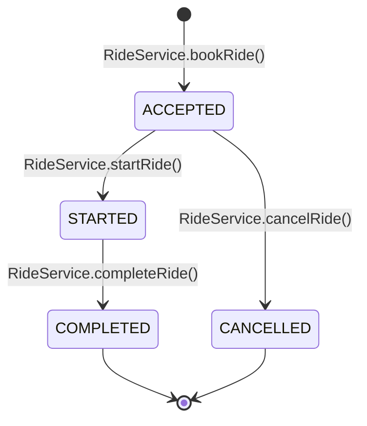

# RideWise — Low-Level Design (LLD) Class Model

This document outlines the detailed class structure, class relationships, and design patterns utilized in **RideWise**.

---

## 1. Class Diagram

```mermaid
classDiagram
    %% Entities and Enums
    class RideStatus {
        <<enumeration>>
        REQUESTED
        ACCEPTED
        STARTED
        COMPLETED
        CANCELLED
    }

    class Rider {
        -String id
        -String name
        -String phoneNumber
        -double currentX
        -double currentY
        +getId() String
        +getName() String
        +getPhoneNumber() String
        +getCurrentX() double
        +getCurrentY() double
        +updateLocation(double newX, double newY) void
    }

    class Driver {
        -String id
        -String name
        -String phoneNumber
        -String vehicleNumber
        -double currentX
        -double currentY
        -boolean available
        -int completedRidesCount
        +distanceTo(double targetX, double targetY) double
        +incrementCompletedRides() void
        +updateLocation(double newX, double newY) void
        +setAvailable(boolean available) void
        +isAvailable() boolean
        +getCompletedRidesCount() int
    }

    class FareReceipt {
        -String receiptId
        -String rideId
        -double distanceKm
        -double baseFare
        -double distanceFare
        -double surgeFare
        -double totalFare
        -String fareStrategyName
        -LocalDateTime issuedAt
        +formatReceipt() String
        +getTotalFare() double
    }

    class Ride {
        -String rideId
        -Rider rider
        -Driver driver
        -double pickupX
        -double pickupY
        -double dropX
        -double dropY
        -double distanceKm
        -RideStatus status
        -FareReceipt fareReceipt
        -LocalDateTime requestedAt
        -LocalDateTime startedAt
        -LocalDateTime completedAt
        +start() void
        +complete(FareReceipt receipt) void
        +cancel() void
        +getStatus() RideStatus
        +getFareReceipt() FareReceipt
        +getRiderName() String
        +getDriverName() String
    }

    %% Strategy Pattern
    class RideMatchingStrategy {
        <<interface>>
        +matchDriver(Rider rider, List~Driver~ availableDrivers, double pickupX, double pickupY)* Optional~Driver~
        +getStrategyName()* String
    }

    class NearestDriverStrategy {
        +matchDriver(Rider rider, List~Driver~ availableDrivers, double pickupX, double pickupY) Optional~Driver~
        +getStrategyName() String
    }

    class LeastActiveDriverStrategy {
        +matchDriver(Rider rider, List~Driver~ availableDrivers, double pickupX, double pickupY) Optional~Driver~
        +getStrategyName() String
    }

    class FareStrategy {
        <<interface>>
        +calculateFare(String rideId, double distanceKm)* FareReceipt
        +getStrategyName()* String
    }

    class DefaultFareStrategy {
        -double baseFare
        -double ratePerKm
        +calculateFare(String rideId, double distanceKm) FareReceipt
        +getStrategyName() String
    }

    class PeakHourFareStrategy {
        -double baseFare
        -double ratePerKm
        -double surgeMultiplier
        +calculateFare(String rideId, double distanceKm) FareReceipt
        +getStrategyName() String
    }

    %% Services
    class RiderService {
        -Map~String, Rider~ riderRepository
        +registerRider(String name, String phone, double x, double y) Rider
        +getRiderById(String id) Optional~Rider~
        +getAllRiders() List~Rider~
    }

    class DriverService {
        -Map~String, Driver~ driverRepository
        +registerDriver(String name, String phone, String vehicle, double x, double y) Driver
        +getDriverById(String id) Optional~Driver~
        +getAvailableDrivers() List~Driver~
        +getAllDrivers() List~Driver~
    }

    class RideService {
        -RiderService riderService
        -DriverService driverService
        -Map~String, Ride~ rideRepository
        -RideMatchingStrategy matchingStrategy
        -FareStrategy fareStrategy
        +bookRide(String riderId, double px, double py, double dx, double dy) Ride
        +startRide(String rideId) Ride
        +completeRide(String rideId) FareReceipt
        +cancelRide(String rideId) void
        +setMatchingStrategy(RideMatchingStrategy strategy) void
        +setFareStrategy(FareStrategy strategy) void
    }

    %% Relationships
    RideMatchingStrategy <|.. NearestDriverStrategy : implements
    RideMatchingStrategy <|.. LeastActiveDriverStrategy : implements
    FareStrategy <|.. DefaultFareStrategy : implements
    FareStrategy <|.. PeakHourFareStrategy : implements

    RideService *-- RideMatchingStrategy : composes
    RideService *-- FareStrategy : composes
    RideService --> RiderService : uses
    RideService --> DriverService : uses

    Ride --> Rider : Association
    Ride --> Driver : Association
    Ride *-- FareReceipt : Composition
    Ride --> RideStatus : tracks
```

---

## 2. Ride Lifecycle State Transition

The life-cycle of a ride is modeled as a deterministic state machine:

### State Transition Invariants:
1. **ACCEPTED**:
   - Driver is matched and marked `available = false`.
   - Ride instance created.
2. **STARTED**:
   - Trip is actively in progress.
   - Guard: Can only transition from `ACCEPTED`.
3. **COMPLETED**:
   - `FareReceipt` is generated via composed `FareStrategy` and attached to `Ride`.
   - Driver coordinates updated to drop-off point.
   - Driver `completedRidesCount` incremented.
   - Driver marked `available = true`.
   - Rider coordinates updated to drop-off point.
   - Guard: Can only transition from `STARTED`.
4. **CANCELLED**:
   - Ride terminated early.
   - Matched driver is released and marked `available = true`.
   - Guard: Cannot cancel a `COMPLETED` ride.

---

## 3. Package & Component Overview

| Package | Class / Interface | Responsibility |
| :--- | :--- | :--- |
| `model` | `Rider` | Stores rider identity, contact, and spatial coordinates. |
| `model` | `Driver` | Stores driver identity, vehicle details, coordinates, availability, and activity count. Implements `distanceTo()` respecting Law of Demeter. |
| `model` | `Ride` | Central entity managing trip participants, coordinates, distance, status, and composed `FareReceipt`. |
| `model` | `FareReceipt` | Immutable financial receipt generated upon ride completion detailing itemized fare breakdown. |
| `model` | `RideStatus` | Enumeration of supported lifecycle phases (`ACCEPTED`, `STARTED`, `COMPLETED`, `CANCELLED`). |
| `strategy` | `RideMatchingStrategy` | Interface defining contract for driver matching algorithms. |
| `strategy` | `NearestDriverStrategy` | Concrete matching strategy picking minimum Euclidean distance driver. |
| `strategy` | `LeastActiveDriverStrategy` | Concrete matching strategy favoring drivers with lowest completed rides (fair distribution). |
| `strategy` | `FareStrategy` | Interface defining contract for fare calculation algorithms. |
| `strategy` | `DefaultFareStrategy` | Concrete pricing strategy: Base Fare + Distance Fare. |
| `strategy` | `PeakHourFareStrategy` | Concrete pricing strategy: Applies surge multiplier during peak demand. |
| `service` | `RiderService` | In-memory CRUD and query service for riders. |
| `service` | `DriverService` | In-memory CRUD, availability filtering, and location service for drivers. |
| `service` | `RideService` | Orchestrator service coordinating booking, lifecycle management, strategy execution, and receipt generation. |
| `exception`| `NoDriverAvailableException` | Checked domain exception thrown when no drivers match requested criteria. |
| `util` | `IdGenerator` | Thread-safe ID generation utility using `AtomicInteger`. |
